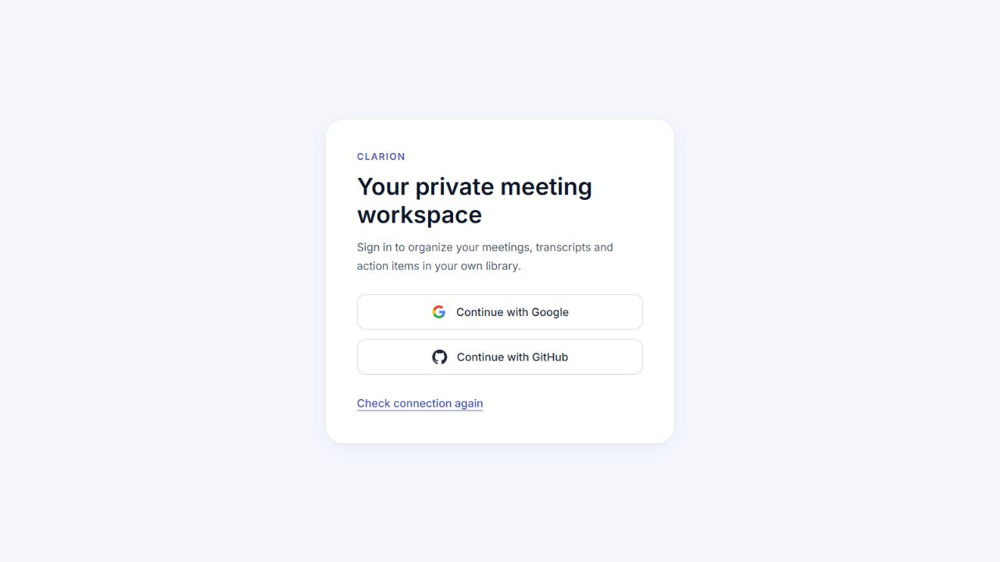

# Private accounts, organization and Docker acceptance — 2026-10-16

This completes the implementation follow-up to the [stability audit](AUDIT_STABILITY_2026-10-16.md): private Google/GitHub sign-in, organized source folders, patched frontend tooling and actual Docker verification. Integration is local; no remote push or external account provisioning is included.

## Delivered

- Server-side Google/GitHub authorization-code flow with PKCE S256, fixed provider identity endpoints, browser-bound single-use state and opaque sessions. Google requests only identity/email/profile; GitHub requests profile/email. Provider access tokens are not persisted.
- Private mode is the default. Each provider subject gets a separate SQLite library, including meetings, FTS, projects, tasks, chat and voice profiles. A request ContextVar retains account selection through worker threads and streamed responses. Matching emails do not merge accounts.
- HttpOnly, SameSite cookies, Secure outside loopback development, 24-hour sessions, logout revocation, strict Origin plus session CSRF for mutations, and no-store responses. The UI clears mounted account state on logout/expiry/account changes and rejects mismatched or stale account responses.
- Manually entered connector PATs/repositories now live only in the open dialog. Startup and account boundaries remove the old shared browser-storage keys.
- Backend modules grouped into `app/api`, `app/auth`, `app/core`, `app/pipeline` and `app/fixtures`; root `main.py` remains a thin compatible entry point. Frontend grouped into `app`, `features`, `shared` and `styles`, with recursive test discovery. Defense guides and midterm reports moved into `docs/defense` and `docs/reports`. See the [source map](source-layout.md).
- Tailwind 4 with its official Vite plugin replaces the vulnerable build dependency chain. Compatibility styling preserves the existing palette/control defaults. CI audits all npm dependencies, including development tooling.
- Docker uses Python 3.11 with CPU Torch/FFmpeg and a Node 24 build plus nginx. Frontend asset compilation uses `BUILDPLATFORM`, with nginx targeting the requested runtime architecture. Compose exposes server-only OAuth configuration, persists identity/account data and has a health probe that works with a strict deployment hostname.

## Verification

| Check | Result |
| --- | --- |
| Windows full backend, `pytest ai-summary-service/tests --run-model-tests -q` | **312 passed**, zero skipped; one upstream Starlette/AnyIO deprecation warning. |
| Python 3.11 lightweight environment, only test requirements | **300 passed, 11 skipped** for optional model/tensor dependencies. |
| Native Linux Docker full backend with actual Whisper models | **312 passed**, zero skipped. Existing model cache and bundled samples were mounted read-only; Docker inspection confirmed `RW=false`. |
| Linux Docker default regression selection | **305 passed, 7 skipped** for explicitly selected model integration; one upstream test-client HTTPX deprecation warning. |
| Frontend `npm test` | **116 passed**, zero skipped. |
| Frontend `npm run lint` / `npm run build` | Exit 0; main entry **487.88 kB**, gzip **152.12 kB**, no large-chunk warning. |
| Complete `npm audit`, including development tooling | **0 vulnerabilities**. |
| Full/lightweight Python `pip check` | No broken requirements. |
| Native Compose images, nginx and API smoke | Static UI, health, FTS insert/update, SSE tokens/citations/completion and RAM audio decode passed. |
| Persistence | Backend restart retained transcript, ISO deadline and chat; the smoke script removed only its own fixture. |
| Private Compose boundary | Public health/session remained available; anonymous meeting reads/writes, analytics and chat streaming returned 401. |
| Deployment hostname | Reproduced the old localhost health probe failure, then verified healthy status with only `meetings.example` allowed using a Host derived from the configured public URL. CI includes this case. |
| Multiplatform builds | Backend and frontend build recipes passed for `linux/amd64,linux/arm64` without publishing. ARM64 results are build validation, not an ARM64 runtime/inference claim. |
| Browser account flows | Actual callbacks/cookies/private APIs with locally mocked provider identity steps: Alice saw only Alice's library, logout removed the workspace, Bob saw only Bob's library. |
| Browser connector/privacy/mobile | Closing/reopening the connector cleared its test token and repository; no issue/email was submitted. The 375 px library and account controls had no horizontal overflow; backdrop dismissal worked. |
| Benchmark | `npm run benchmark` regenerated [the measured report](BENCHMARK_REPORT.md). Values describe the fixtures and this machine, not overall accuracy or end-to-end latency. |

The independent review reported two Important findings: shared connector PAT persistence and the deployment-host healthcheck. Both were reproduced before correction and verified afterwards. No Critical finding was reported. The account regressions also cover stolen/replayed/expired OAuth state, generic provider failure, hashed tokens, expired/revoked sessions, CSRF failures, direct-ID reads/writes/deletes, search/projects, same-email provider separation, concurrent SSE/chat and voice-profile isolation, and preservation of the local library.

Browser evidence uses disposable Alice/Bob fixtures, not user records:

[Alice library](audit-artifacts/private-alice-library.png) · [Bob library](audit-artifacts/private-bob-library.png) · [375 px library](audit-artifacts/private-mobile-library.png)

## Owner setup and remaining boundaries

Actual external Google/GitHub consent has not been exercised: provider applications/client credentials must be created by the owner. Fill the four provider variables in a private root `.env`, set the exact public/callback origins and restart. [.env.example](../.env.example) and the [OAuth setup guide](auth-setup.md) specify both direct-development and Docker callbacks. Without these credentials, provider buttons stay unavailable and the private API stays locked. No dummy authentication path is enabled in production.

The browser QA fixture is an explicitly launched test server under `tests/fixtures`; it substitutes external providers, creates only temporary databases and is never imported by production. Physical microphone permission/capture was not exercised; controller behavior and real transcription/decoding were tested separately. ARM64 containers were built, not run on native ARM hardware. Deployment HTTPS termination and externally registered OAuth clients remain deployment-specific checks.

Disposable Compose tests use `docker/compose.smoke.yml` with a unique project and a named test data volume. They do not mount the working `database/` directory. The final SHA-256 of the original local database matches its baseline. The test containers, network and volumes have been removed; images/build cache are retained. The original local database remains unassigned to any new account, and the existing pre-rescue benchmark stash remains preserved. Docker Desktop's stale runtime socket was backed up during engine recovery; no factory reset or image/credential deletion was used.

Docker evidence is retained locally in `%TEMP%/clarion-docker-20261016`, including the full Linux model test log, read-only mount inspection, strict-host health results, both platform build logs and the cleanup/database-hash comparison. Windows integration logs are `%TEMP%/clarion-integration-backend.log` and `%TEMP%/clarion-integration-frontend.log`.
