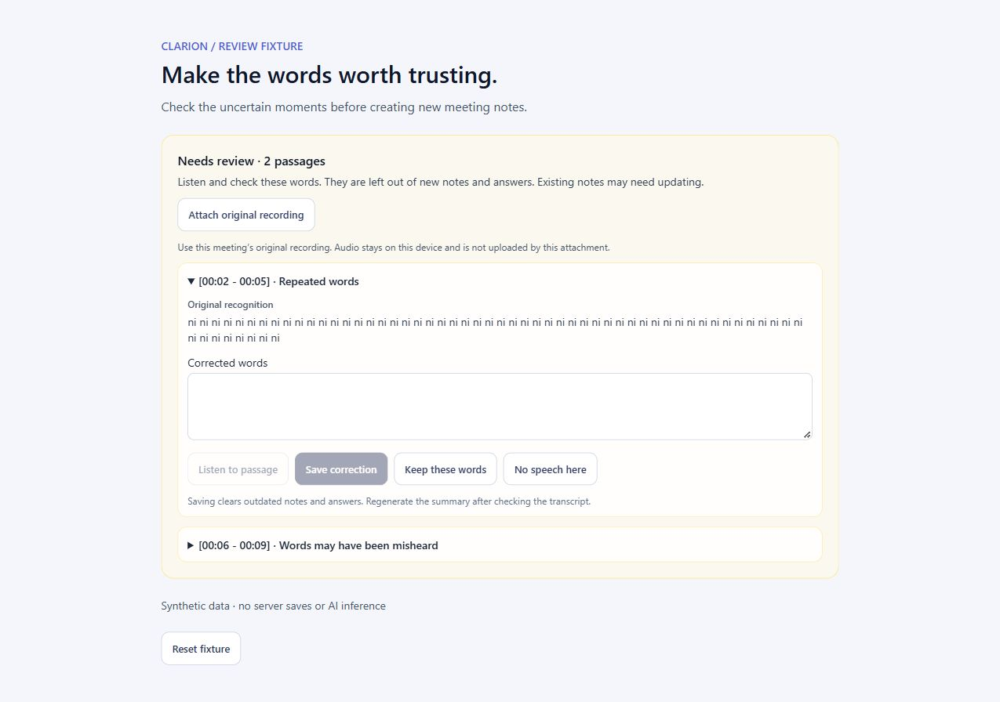
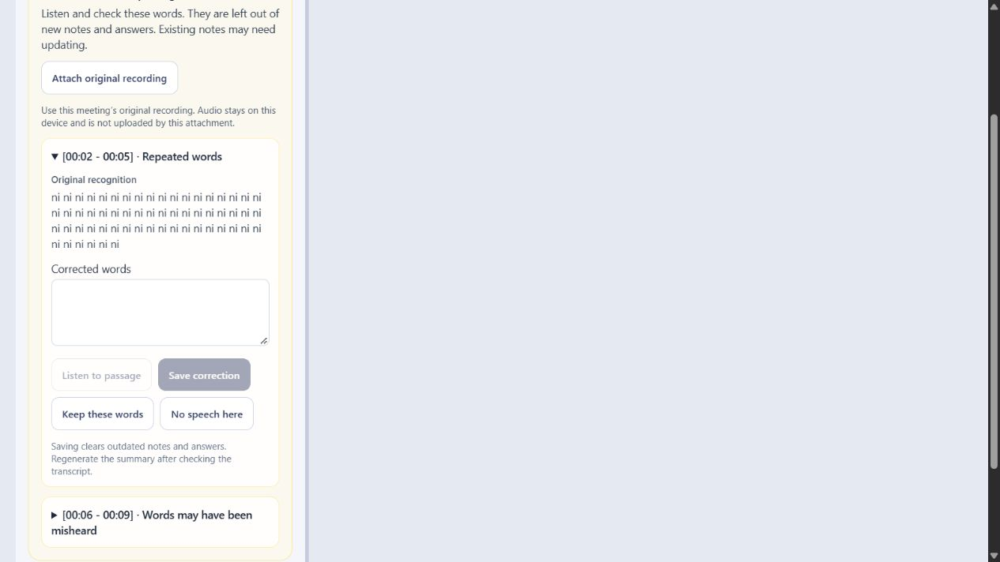

# Speech review release validation — 17 October 2026

This release adds evidence-preserving uncertain-passage review and fixes speech decoding integration. It preserves the existing feature-based source organization and user interface work.

## Verified behavior

- Repetition and low recognition probability request human review. Original words remain available; unresolved words are excluded from new summary, action/insight generation and chat evidence.
- Short and long recordings use canonical segment text; decoding fallback/silence rules no longer incorrectly delete individual good segments.
- Automatic detection remains independent across long-recording chunks. An unexpected detected language produces a visible warning rather than a claim that accents are solved.
- Correction, explicit confirmation and no-speech review invalidate stale generated output. Revision conflicts preserve local correction drafts. Drafts never carry between meetings, including identical repetition at the same timestamps.
- Previously reviewed legacy speech stays confirmed through summary edits, regeneration, task changes, speaker edits and the legacy update route.
- Floating chat restores keyboard focus and avoids a decorative, unverified online claim. Review controls wrap on narrow screens and respect reduced-motion preferences.

## Verification evidence

| Check | Result |
| --- | --- |
| Full provisioned backend, `python -m pytest ai-summary-service/tests --run-model-tests -q` | 428 passed; one upstream Starlette/AnyIO deprecation warning |
| Frontend, `npm test` | 161 passed |
| `npm run lint` | Passed |
| `npm run build` | Passed |
| `npm audit --audit-level=moderate` | 0 vulnerabilities |
| Independent focused review | Two P2 findings reproduced and fixed; final recheck found no remaining actionable issue within scope |
| Browser interaction | Synthetic correction, confirmation and no-speech queue transitions checked; unavailable listening without audio is disabled |
| Responsive browser check | 375px iframe, wrapping controls; document scroll width equals client width (370px after scrollbar) |

Tests isolate temporary storage and provider configuration. No private account database or source recording was committed. The user-provided recording was sampled locally only; no full-recording accuracy measurement was performed. The existing [pilot evidence](../../defense/evaluation/2026-10-16-pilot/README.en.md) remains tied to its original inference revision.

The manual fixture is `meeting-assistant-ui/tests/speech-review.html`, with a 375px wrapper at `tests/speech-review-mobile.html`. It uses the production review component and session reducer but synthetic source and local callbacks: it is not a server persistence or audio accuracy demonstration. App regressions and backend transaction tests check those save/revision boundaries separately.

## Freeze and handoff

The final source commit is recorded in the generated `MANIFEST.json`. The submission tag identifies that immutable tree; later branch changes do not replace the tagged submission. Generate the archive from a clean committed checkout using `python scripts/submission/package_source.py --output dist/submission`, then verify its SHA-256 against `archive_sha256` and check extracted files against the manifest. Never include runtime data or rewrite the historical pilot measurements.

CI status must be checked for the exact final commit in [GitHub Actions](https://github.com/vanhgonnasleep/AI-Meeting-Assistant/actions). Quality checks and Compose smoke verification are separate workflows. Multi-platform image builds are a separate manual workflow gate and are not implied by a successful Compose run.

The English [project report](../../submission/PROJECT_REPORT.md) accompanies the code. The presenting team owns slides and rehearses with [HANDOFF.md](../../submission/HANDOFF.md).
