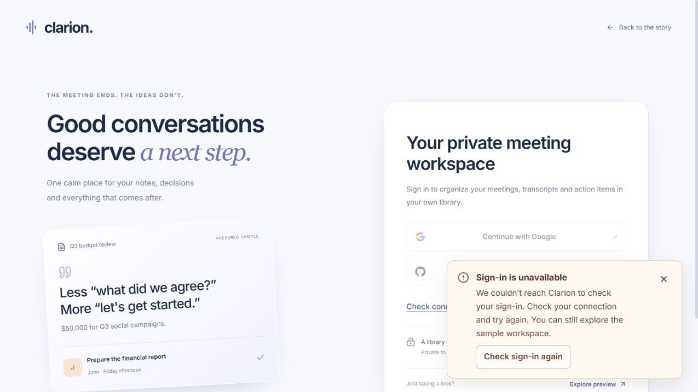
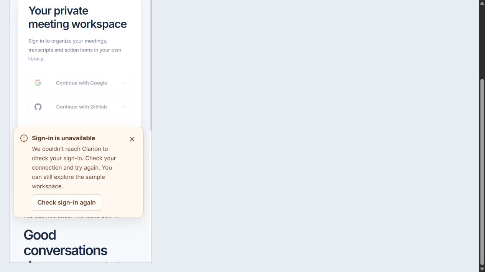
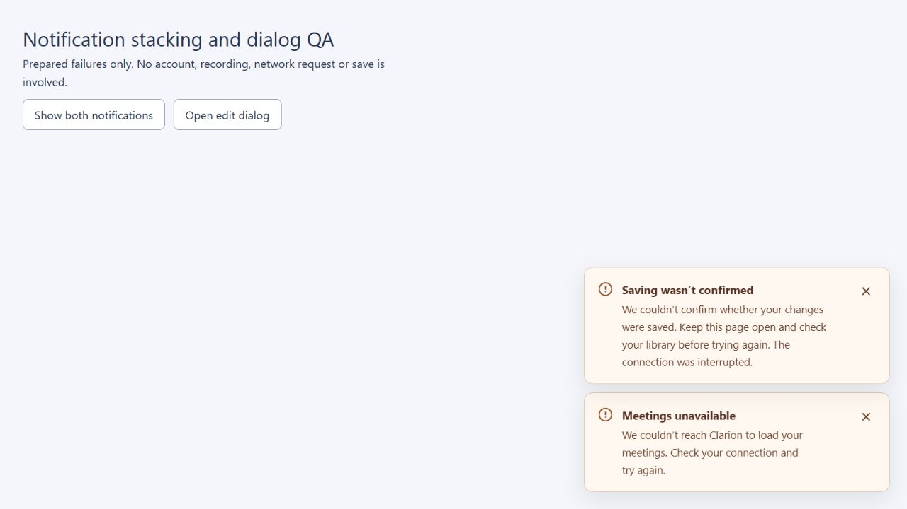
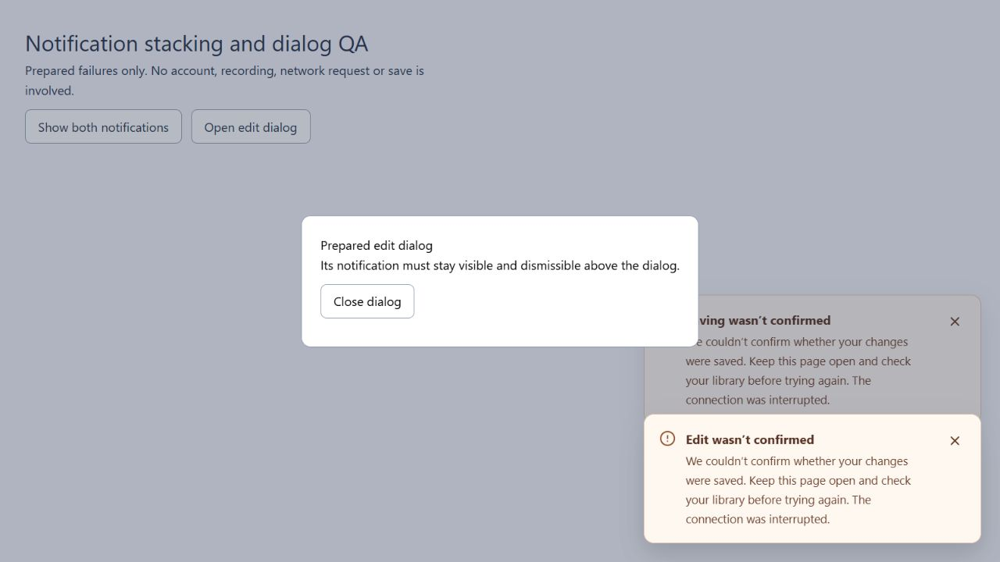

# Business-language errors and floating notifications

The operational UI uses bottom-right notifications instead of raw browser/server exceptions. On mobile, they sit above the recording dock. Error notifications persist until dismissed; routine success notices may disappear after a short interval. No failed write is automatically retried.

Concurrent notifications use measured heights and compact after dismissal. Native edit dialogs have a separate geometry scope so their controls remain usable above the dialog backdrop. Dismissing a notification does not turn an unsuccessful load into an empty library or remove the remaining reload path.

## Message contract

Each message identifies the affected user task and a practical next step. Causes are stated only when known. A browser fetch rejection alone cannot distinguish an unavailable service, a blocked browser connection or some network failures; the UI therefore says it could not reach Clarion rather than inventing a database failure.

| Condition | User-facing behavior |
| --- | --- |
| Device reports offline | Ask the user to reconnect |
| Connection failed | Explain that Clarion could not be reached and offer connection/retry guidance |
| Save/delete/process outcome unknown | Explain the uncertainty and ask the user to check before repeating the action |
| Another version was saved | Explain the conflict and preserve edits before reloading |
| Meeting no longer available | Return to the library and choose another meeting |
| File or recording too large/long | Suggest a smaller file or shorter recordings |
| Invalid fields | Name recognized fields, such as due date; never echo rejected input |
| Microphone denied/missing/busy | Explain permission, connection or competing-app recovery |
| Unexpected response | Use a safe message for the affected operation |

Successful authenticated responses still require the account identity header. A different account or an expired session invalidates the workspace. An unsuccessful service response without that header no longer signs the user out by itself.

`shared/lib/user-errors.js` owns classification and approved copy. `features/auth/api-client.js` handles request failures and preserves cancellation/account boundaries. `shared/ui/FeedbackNotice.jsx` owns accessible floating presentation, with styles in `styles/feedback.css`. Business recovery copy is English. Validation remains near the input when that helps correction; failure to load is distinct from a successfully loaded empty library.

The frontend refinement follows the existing stack and identity. Design references inspected at fixed revisions:

- [Impeccable](https://github.com/pbakaus/impeccable/tree/6af45ac9a5eb8792f033d3242f52e99812fd91fa): clarification, hardening and craft guidance.
- [Taste redesign skill](https://github.com/Leonxlnx/taste-skill/blob/f624f37a8c650b9cc550253104925efe4c8de246/skills/redesign-skill/SKILL.md): targeted improvements to an existing interface, feedback states, readable type and accessible controls.

These references informed the implementation; their runtime, hooks and packages were not installed into Clarion. No third-party source code was copied into the product.

## Browser verification

Sign-in recovery was refined further after this release. See the [final sign-in audit](../signin-final/README.md) for the current behavior; the earlier screenshots below record the initial notification layout.

The connection-failure state was tested on a disposable Vite development server with an intentionally unreachable API URL. The running production/development backend was not stopped. At a 1275px viewport the notification stays in the bottom-right corner; a same-origin 375px iframe verified readable wrapping and complete controls. This is an emulated viewport check, not a physical-device certification. Dismissal was exercised in the browser and DOM regressions.

