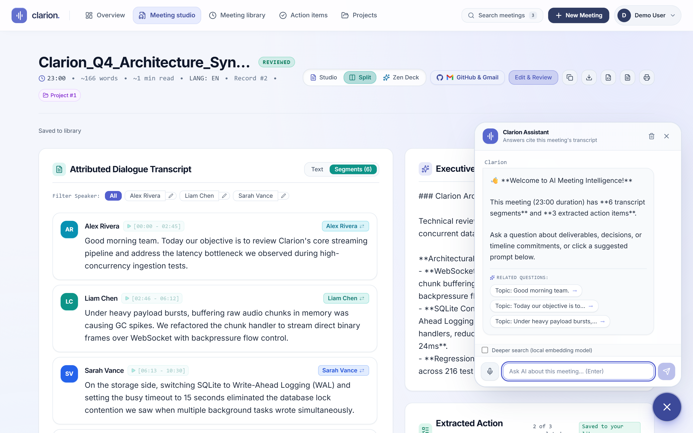
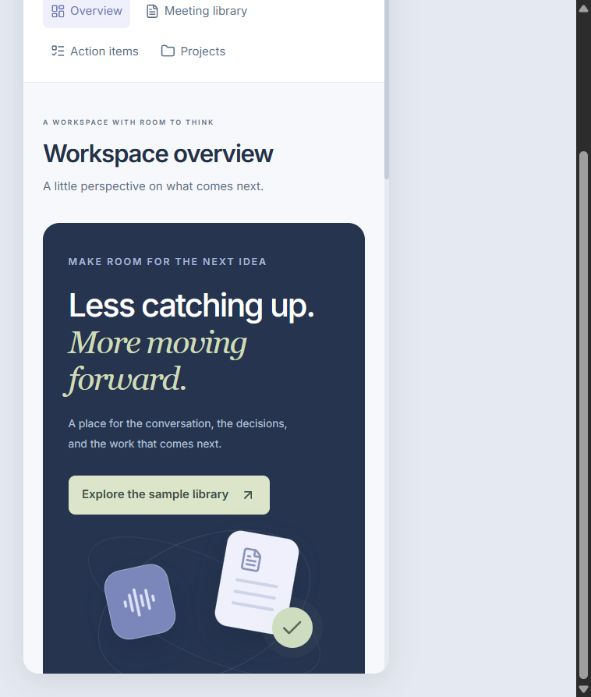
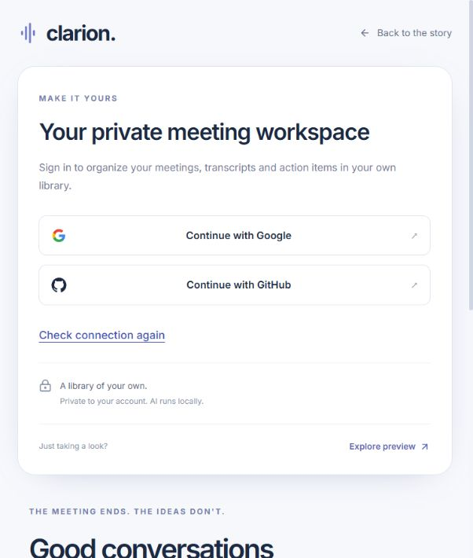
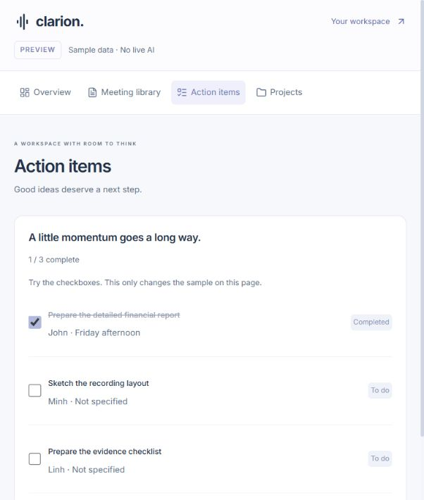

# Public preview and sign-in refresh — 2026-10-16

The old account gate hid the existing product landing/demo behind a sign-in card. Visitors now see the product before deciding to sign in:

- `/` or `#/landing`: public introduction and the recorded sample, with a visible Preview workspace CTA.
- `#/preview/overview`: a prepared workspace with overview, searchable meeting notes/transcript, reversible task checkboxes and project progress. One recording is bundled; two additional text cases are marked illustrative. No live inference, private-library requests or saves occur in the preview components. These sample counts are not AI quality measurements.
- `#/signin`: a two-column product/sign-in view, with provider availability, retry/error recovery and routes back to the public preview.
- Private deep links still require a session. Backend authorization, OAuth scopes and account storage were not weakened.

Preview tasks live in component memory and reset when leaving preview. A fresh preview mounts no private App, even for a signed-in visitor. After the visitor explicitly opens their private workspace, that App remains hidden/mounted while previewing so active work survives; its existing in-flight work may continue. Sign-out or account changes discard the retained account state. Sample content is never copied into that library.

## Organization

`app/entry-navigation.js` resolves public entry routes separately from private navigation. `features/landing/components` owns public navigation; `features/auth/components` owns provider controls. `features/preview/components` owns the sample panels, `features/preview/data` owns fixtures, and feature styles remain colocated. Shared marks, lazy loading/recovery and existing authenticated feature folders are reused. See [source layout](../../source-layout.md).

## Validation and review

Four initial DOM regressions cover anonymous landing, offline preview without private API calls, protected deep links and skip-link navigation. Further regressions cover OAuth cancellation/provider failure, retained unsaved drafts, no private App on fresh authenticated preview, and cleanup of retained state after sign-out. The cancellation and draft-loss tests were observed RED before their fixes.

Frontend: 132 tests pass; lint/build pass; npm audit has no reported vulnerabilities. Main JS is 493.30 kB (153.65 kB gzip); preview is a separate 12.94 kB chunk. Backend application behavior is unchanged. The model-enabled and lightweight CI environments were checked separately.

The lightweight Python 3.11 check initially exposed two evaluation preflight tests that depended on optional Whisper installation. Preflight now gives explicit missing-dependency guidance, and the capability-separation unit test injects a model fixture. Its regression was observed RED→GREEN. The lightweight suite passes 365 tests with 11 optional tests skipped, without installing/downloading Whisper weights. Official v7 tags for checkout/setup-python/setup-node were also verified before push.

Final checks after local integration: **377 backend tests pass** with real-model tests enabled; **132 frontend tests pass**, lint/build pass, npm audit reports zero vulnerabilities, and pip check reports no broken requirements. One upstream Starlette/AnyIO deprecation remains. Logs are `%TEMP%/clarion-public-preview-main-backend-final.log`, `%TEMP%/clarion-public-preview-main-frontend.log`, and `%TEMP%/clarion-public-preview-ci-lite-final.log`. Earlier rescue/evaluation commits are included in the authorized main push; the benchmark stash and unrelated worktree are preserved.

An independent reviewer confirmed that preview imports only prepared fixtures/public assets and identified the OAuth failure-return regression. The reviewer hit an account usage limit before completing its verdict. The implementer traced and corrected the remaining lifecycle issue and completed source review plus regression validation; this is not represented as a completed independent approval.

Browser QA exercised the public landing/CTA and preview at desktop, a 602px viewport (no horizontal overflow), and a 375px iframe fixture at `tests/public-preview-mobile.html`. OAuth on the temporary QA port was intentionally unavailable because production CORS origins were not expanded. After integration, both configured provider buttons were enabled on port 5173; public sample task toggling worked there without sign-in. No new external provider consent was performed.

Before push, all 310 unique blobs in the 41 existing outgoing commits were checked for known Google OAuth secrets, GitHub token/private-key patterns, long provider-secret literals and private runtime files. No matches were found; `.env` is ignored and absent from Git history. This bounded pattern check is not an exhaustive secret/security certification. No credentials or account databases are included in the UI screenshots.

