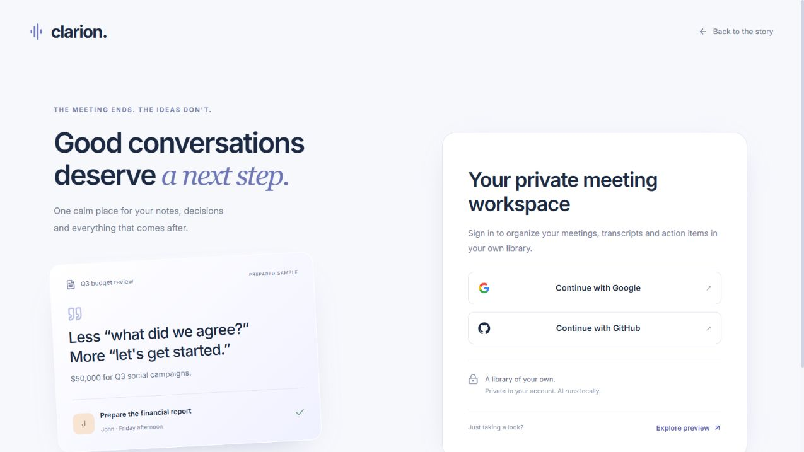

# Final sign-in and recovery audit

The healthy sign-in page shows the available providers without a connection-check link. Refreshing an already successful availability check had no useful outcome.

Only a failed sign-in check exposes **Try again**. The action remains in the sign-in panel after dismissing its notification, shows a checking state, and disappears after recovery. The entire request, including response-body parsing, has a ten-second limit. Cancellation and stale responses cannot restore an old account. Invalid provider/account payloads receive safe recovery copy.

OAuth cancellation, verification failure and expired-session notices direct the visitor to sign in with a provider. Repeating the session check does not restart OAuth, so those states no longer offer that misleading recovery action.

The final adjacent-flow audit also found and fixed:

- Recording-control and notification keys could collide after sample/new-meeting actions. Separate key namespaces prevent React from confusing those siblings.
- A temporary session-check failure could unmount an explicitly selected local workspace. Its unsaved draft now survives, matching private-workspace behavior.
- Dismissing a failure notification could hide the only retry action. The conditional panel action remains available.

Validation: 152 frontend tests pass; lint/build and npm audit pass. New timeout/body-timeout, cancellation, malformed-session, retry progress/dismissal, local-draft and key-collision regressions exercise these cases. The new behavior regressions were observed failing before their fixes. An independent reviewer ran 33 targeted tests and found no remaining actionable issue in the changed authentication/recovery flows. This is a focused final audit, not a guarantee that every possible workflow or security condition has been tested.

The full model-enabled backend suite also passes 384 tests, with the existing upstream Starlette/AnyIO deprecation warning. Browser verification on the normal application port confirmed that both provider buttons are enabled and the unnecessary connection-check link is absent. No external OAuth consent was performed during this check.

